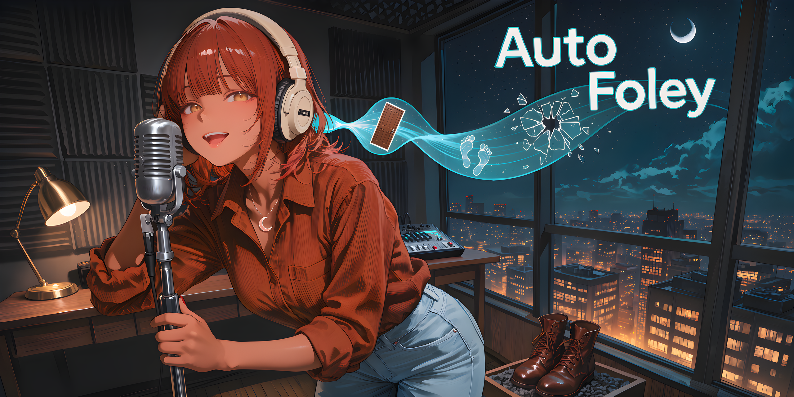

<p align="center">
  
</p>

# Auto Foley

A Lumiverse extension. It gives voice acting and sound effects to your TTS, so a reply is read like a performance, with a voice for everyone in it.

## What it does

- A second model, the **Director**, marks how each line is said, with voice tags such as `[whispers]`, `[sighs]` or `[through gritted teeth]`.
- Sounds go with what happens: a door, footsteps, a glass breaking. They can be made inside the voice or as separate sound effects.
- Everyone who speaks gets their own voice: your personas, the characters and the NPCs. New speakers are added by the AI, or by you.
- An optional **Decision model** picks who says each quoted line.
- It never changes the words of your story. Only the copy sent to the voice gets tags.

It works only with models that act: ElevenLabs v3 and v4, Fish Audio S2 and Drama 3, Gemini 3.8, Chatterbox-Turbo, OmniVoice through OpenVox, and Cartesia Sonic 3. ElevenLabs, Fish Audio and Gemini also work through OpenRouter. See [Voice engines](docs/engines.md).

## It replaces Lumiverse's own TTS

Auto Foley is a replacement for Lumiverse's own TTS, with more options. By using it, you accept that:

- It reads your messages with its own player and its own settings, in place of Lumiverse's.
- It speaks through your TTS connections in Lumiverse, with its own voice settings in place of the ones saved on the connection, such as how a line is said and a higher quality. See [Sound quality, and where it replaces Lumiverse's TTS](docs/engines.md#sound-quality-and-where-it-replaces-lumiverses-tts).
- A voice can sound different than with Lumiverse's own TTS. This is on purpose.

## Install

1. In Lumiverse, open **Settings**, then **Extensions**, then **Install**.
2. Install from this address:

   ```
   https://github.com/starlitcode/Lumiverse-Auto-Foley
   ```

3. Turn on Auto Foley and grant its permissions.
4. To see it, open the drawer and choose the **Foley** tab, with a headphones icon. **Play**, under **Now playing** on the Stage tab, performs the latest reply.

You also need a TTS connection in Lumiverse, under **Connections**, in the TTS section. Auto Foley speaks through it, so its key stays in Lumiverse.

Once a message has been performed, a small player sits under its text, with Back, Play and Next. A button on every message and a floating player over the chat can be turned on in the Settings tab. See [Getting started](docs/getting-started.md).

## You are in control

- **Stop** stops at once. A Director still writing is stopped too, so nothing more is spent.
- Nothing plays by itself unless you turn on **Autoplay new replies**. It is off by default.
- Saved audio plays again with nothing spent. **Saved audio**, in the Studio, lists it, and **Delete** removes it.
- Every built-in prompt, note and pattern can be read and changed in the panel, with a way back to the built-in one.
- **Auto Foley is on**, in the Settings tab, switches it off everywhere. **Turn off here**, under it, switches it off in one chat.

## Documentation

**Start here**

- [Getting started](docs/getting-started.md): set it up and perform your first message
- [A tour of the Studio](docs/studio-tour.md): make a video of a performance, on a laptop or a phone

**Going further**

- [Voice engines](docs/engines.md): what each engine can do, and how to set up Chatterbox, OpenVox and Cartesia
- [Sound quality](docs/engines.md#sound-quality-and-where-it-replaces-lumiverses-tts): the format each engine sends, and where Auto Foley replaces Lumiverse's own TTS settings
- [The Director](docs/director.md): what it does, what it is sent, and its prompt
- [The cast](docs/cast.md): voices for personas, characters and NPCs
- [Writing for each voice engine](docs/writing.md): which box is read by what, and examples to copy for each engine
- [Sounds](docs/sounds.md): sounds in the voice, sound effects and your library
- [Scene music](docs/music.md): music for the mood of the scene, from your library or Freesound
- [The Studio](docs/studio.md): keep a performance as audio or a video, and hide words in it

**About it**

- [Privacy](docs/privacy.md): what the extension sends and where, what it keeps, and how to check any of it
- [Security policy](SECURITY.md): how to report a security problem
- [Contributing](CONTRIBUTING.md): what to put in a bug report
- [Changelog](CHANGELOG.md): what changed in every version

## How it works

- It listens to Lumiverse's own generation events, and reads the message you perform.
- The Director is asked through one of your connections in Lumiverse. The voice is made through your TTS connection, with Lumiverse's own TTS route, so every key for them stays in Lumiverse.
- A small backend keeps your settings, cast, sounds and saved audio with your account, not in one browser.
- Its only calls of its own go through Lumiverse's CORS proxy: to Freesound and ElevenLabs for sound effects, with your own keys, and to a Chatterbox server you add. [Privacy](docs/privacy.md) covers the four permissions it asks for and what still works without each one.
- The files Lumiverse loads are `dist/frontend.js` and `dist/backend.js`. They are plain, readable JavaScript. Nothing is minified. [Privacy](docs/privacy.md#checking-any-of-this-yourself) goes through the rest of the repo file by file.

## Help and feedback

Questions, bug reports and ideas are welcome in my [Auto Foley post](https://discord.com/channels/1484149939167821915/1573804219419590667) on the Lumiverse Discord server, or as a [GitHub issue](https://github.com/starlitcode/Lumiverse-Auto-Foley/issues). [Contributing](CONTRIBUTING.md) says what to put in a bug report.

## Made for adults

Auto Foley is for adults, 18 and older. It is not for sexual content involving minors, and I do not support anyone using it for that. I do not help anyone who tells me they are under 18, with anything. [The one thing it does not direct](docs/director.md#the-one-thing-it-does-not-direct) says exactly how the built-in prompt handles it.

## Credits

- **starlitcode**: built and maintains the extension
- **[Claude](https://claude.ai)** (Anthropic): wrote the code, directed and tested by starlitcode
- **[Choir](https://github.com/patatasbravasch-arch/Choir)**: the extension that showed a voice for every character, with sound effects, was worth having, and inspired the floating player. Auto Foley is written from scratch and shares no code with it
- **[Chat Voice](https://github.com/WanderingMonk8/custom_voice)** by WanderingMonk8: the extension that showed a TTS voice for each speaker in a chat was worth having. Auto Foley is written from scratch and shares no code with it
- Everyone who has reported a bug or suggested something that turned into a fix

Licensed under the GNU General Public License v3.0. See [LICENSE](LICENSE).
