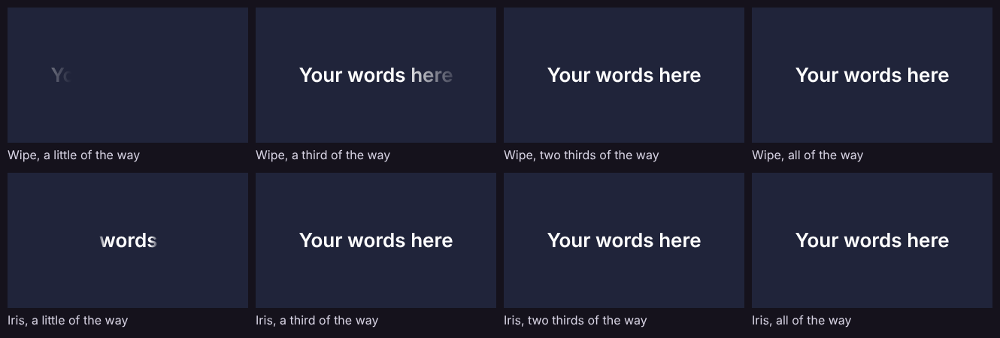

# Animations

## In short

- **Animations**, in the Studio, picks how each part of the video comes in and goes out.
- There are eleven places: six for the whole frame and five for text.
- Calm glitches, such as **Color split** and **Signal lost**, are built in too.
- Each place has a dropdown. **Default** keeps what the Studio did before an animation was picked.
- Pick a built-in animation, such as **Rise**, **Wipe from the left** or **Typewriter**, or one of your own.
- Each picked animation has a typed **Length, in seconds** and **Delay, in seconds**.
- The built-in animations are calm. None of them flashes.
- Animations are part of a saved look and of a project.

## Steps

1. Open the Studio, and pick **Animations** in the list of parts.
2. Find the place, such as **Lines**, and pick an animation in its dropdown.
3. Type its **Length** and **Delay** if you want them other than the built-in ones.
4. Play the preview. Each change shows at once.
5. Pick **Default** to go back to how the place was.

## What it sends

Nothing. Animations are drawn on your device, in the preview, full screen and every saved video. Your choices are kept with your settings on your account.

## An example

Ines Marlow makes a video of a quiet harbor scene.

1. **Opening**: **Iris**, 2 seconds. The video starts black, and a circle opens from the middle to show the frame.
2. **Title and byline**: **Typewriter**, 1.6 seconds. The title "Harbor Lights At Dusk" is typed in a letter at a time. The line under it fades in once the title is all shown.
3. **Lines**: **Slide from the left**. Each line comes in from the left and leaves to the right. Pictures still move to their new place as before.
4. **Ending**: **Iris**. Over **Fade to black at the end**, the circle closes on the middle.

Half way through the opening, the corners are still black and the middle of the frame shows. A quarter of the way through the ending, the corners are black again and the middle still shows.

## The places

| Place | Kind | Default |
| --- | --- | --- |
| Opening | The whole frame | In from black |
| Ending | The whole frame | Out to black |
| Between lines | The whole frame | The transition under **Moving between lines** |
| Scene change | The whole frame | The same as between lines |
| Background on a scene change | The whole frame | A slow fade |
| Pictures | The whole frame | They move to their new place |
| Lines | Text | The same as between lines |
| Words | Text | As set under **How the words show** |
| Title and byline | Text | Fade |
| Captions | Text | The same as lines |
| Watermarks | Text | Fade |

- **Between lines** moves the whole part as one: its pictures, names and words.
- **Lines** moves only the words and the names. Pictures move as **Pictures** says.
- With both picked, the whole part moves as **Between lines** says, and the words inside it move as **Lines** says.
- **Scene change** is used in place of **Between lines** where a new scene starts.
- **Pictures** is used for a speaker who comes in or goes. A speaker who stays moves to their new place.
- **Words** moves each word in as it is said. The words not said yet are not shown.
- **Captions** is used for sound captions, such as [thunder]. With it on **Default**, they move as **Lines** says.
- **Watermarks** is used at the start and the end of each watermark's time. A watermark shown during some backgrounds keeps its fade.

## The built-in animations

| Animation | In | Out | Length |
| --- | --- | --- | --- |
| Fade | Fades in | Fades out | 0.5 seconds |
| Rise | Fades in, rising 24 pixels | Fades out, rising 24 pixels | 0.5 seconds |
| Drop | Fades in, dropping 24 pixels | Fades out, dropping 24 pixels | 0.5 seconds |
| Slide from the left | Comes in from the left | Leaves to the right | 0.5 seconds |
| Slide from the right | Comes in from the right | Leaves to the left | 0.5 seconds |
| Slide from the top | Comes in from above | Leaves downward | 0.5 seconds |
| Slide from the bottom | Comes in from below | Leaves upward | 0.5 seconds |
| Soft focus | Comes into focus as it fades in | Goes soft as it fades out | 0.5 seconds |
| Wipe from the left, right, top or bottom | A soft edge moves across and shows it | The edge moves on and hides it | 0.7 seconds |
| Grow | Grows from 92% as it fades in | Shrinks to 92% as it fades out | 0.5 seconds |
| Iris | A circle opens from the middle | The circle closes on the middle | 0.8 seconds |
| Typewriter | The letters show one at a time | Fades out | 1.2 seconds, text only |
| Word by word | The words show one at a time | Fades out | 1 second, text only |
| None | Shows at once | Goes at once | 0 seconds |
| Color split | Fades in as its red and blue-green parts come together | Fades out as they drift apart | 0.6 seconds |
| Slice shift | Bands of the frame slide back into line | Bands slide out of line | 0.6 seconds |
| Scanline wobble | Thin rows move in a slow wave that flattens out | The wave grows | 0.7 seconds |
| Pixel shuffle | Squares of the frame appear, each at a moment of its own | Squares go, each at a moment of its own | 0.7 seconds |
| Signal lost | A still card that says "Signal lost" fades into the frame | The frame fades into the card | 1.2 seconds, the frame only |

Pixels are pixels of a 1080-pixel frame, so they look the same at any size of video.

The last five are calm glitches. They move smoothly, and none of them flashes: a check draws each one at 30 frames a second and finds no fast change between light and dark.

## Your animations

Under the places, **Your animations** makes animations of your own. Up to 30.

### Making one

1. Pick a built-in in **Start from**, and press **Make an animation**. A copy of it is made, named such as "My rise".
2. Press its name in the list to change it.
3. At the top are its **Name**, **Duplicate**, **Share** and **Delete**.
4. The Studio's own preview, at the top, plays the animation, coming in and going out, over and over, on your background. Under it are **Play** or **Pause**, **Half speed**, and **Where in the animation** to look at one moment. With Reduce motion on, it starts paused. Nothing in the settings stays pinned.
5. **What does it move?**: **Both** text and the frame, **Text** only, or **The frame** only.
6. **Length** and **Delay**, in seconds, for coming in and going out.
7. **Coming in** and **Going out** each have a row of cards. Each card plays a small example of its effect. Press one to use it.
8. Under the card picked are only the settings that effect has:
   - **Slide**: **Direction**.
   - **Wipe**: **Direction** and **Soft edge**.
   - **Iris**: the middle of the circle, and **Soft edge**.
   - **Through a shape**: the shape, its middle, **Size**, **Soft edge** and **Turn the other way**.
   - **Typewriter** and **Word by word** are for coming in, on text.
   - The others have no settings of their own.
9. Pick your animation in a place's dropdown, under **Your animations**.

### Reveal

A reveal shows the layer bit by bit, through a shape: a wipe across, or a circle that opens. Only the layer is drawn. The shape decides which part of it shows.

**Wipe**, **Iris** and **Through a shape** use a reveal. Its settings:

- **The shape it shows through**: **Circle**, **Box** (a rectangle that opens from its middle), **Diamond**, **Clock** (a sweep around its middle), **A shape** from the shape picker, such as a heart or a star, or one of [Your reveals](#your-reveals).
- **Direction**, for a wipe: from the left, the right, the top or the bottom. On the timeline, any angle in degrees.
- **Middle across** and **Middle down**, in percent of the frame. Or press and drag on the Studio's preview. It snaps to the middle and the thirds.
- **Size**, in percent: 100 opens to cover the frame. Less stops part of the way. More opens past the edge.
- **Soft edge**: from sharp to very soft, set by eye on the preview.
- **Turn the other way**: hides through the shape, in place of showing.

### Your reveals

**Through a shape** can also show the layer through a shape of your own. Under the shapes, three buttons make one:

- **Draw your own**: draw an outline with the pen.
- **Use a picture**: a PNG or WebP picture, or one of your stickers. **Shows through** picks **Its solid parts** (see-through parts hide the layer) or **Its light parts** (dark parts hide it).
- **Use text**: a word or two, in a font from the font picker. The layer shows through the letters.

Each is saved as you change it, under its **Name**, and is then one of the shapes to pick. It has every reveal setting: the middle, **Size**, **Soft edge**, **Turn the other way**, and on the timeline, how open it is at the start and the end. **Duplicate** makes a copy. **Delete** asks first, and an animation that used it shows through a circle in its place. Up to 20.

#### Drawing one

Ada Quill wants a word to come in through a triangle.

1. She makes an animation, and under **Coming in** presses **Through a shape**, then **Draw your own**. The pen is over the Studio's preview.
2. She taps the top middle of the preview, then the bottom right, then the bottom left. A dashed line joins the points.
3. She taps the first point, which is larger and yellow. The shape closes, and the line is solid.
4. She drags the small square in the middle of the bottom line down a little. That line bends into a curve.
5. She drags the bottom right point a little further out.
6. **Undo a point** takes the last point out, and **Start the shape again** clears them all. **Draw on the preview** turns the pen off and on.

The preview shows the layer through the triangle as it opens. Points snap to a grid and to the lines of the other points, so a straight edge is easy to make. A drawn shape is also **Your own shape** in a design's shapes, under **Background**.

### The timeline

**Show the timeline** is off by default. On, it shows everything under the simple choices:

- **Overlap**, **Turns and sizes around**, **Show the text** and **Easing**: a preset, or the four numbers of a curve, as in CSS `cubic-bezier`, with a small drawing of the curve.
- **Track**: **Coming in** or **Going out**, each with its keyframes and its reveal.
- A reveal on the timeline also has **How open at the start** and **How open at the end**, in percent, **Easing of the reveal**, and, for a clock, **Which way it turns** and **Where it starts**.

The timeline starts from what the cards made, so nothing is lost. Turning it off keeps any change made on it, and **Coming in** or **Going out** then says "Custom timing is kept. Turn the timeline on to change it." Pressing a card replaces the custom timing with that effect.

### Keyframes

A keyframe is a moment of a track, from 0% (its start) to 100% (its end). Between two keyframes, each value moves in a straight line, along the easing curve. A value no keyframe sets stays at rest.

| Value | At rest | Range |
| --- | --- | --- |
| Strength, in percent | 100 | 0 to 100 |
| Across and Down, in pixels | 0 | -2000 to 2000 |
| Size, in percent | 100 | 0 to 400 |
| Turn, in degrees | 0 | -720 to 720 |
| Blur, in pixels | 0 | 0 to 60 |
| Brightness, in percent | 100 | 0 to 200 |
| Tint, in percent, with its color | 0 | 0 to 100 |

A track has up to 12 keyframes. **Add a keyframe** adds one after the last. **Delete this keyframe** takes it out.

Fast changes between light and dark can flash. Keep brightness changes slow.

### Sharing

- **Share** saves the animation in a file, `auto-foley-animation-` and its name. The file holds the animation and the version of Auto Foley. Nothing else is in it.
- **Add from a file** adds the animations in such a file. One with a name you already use is added as a copy, so nothing is replaced.
- **Duplicate** makes a copy to change.
- **Delete** asks first, and says which places use it. Those places go back to **Default**.

## Effects that flash

Some effects flash or flicker. They are hidden until you turn them on.

1. Open **Animations** and turn on **Show effects that flash**. It is off by default.
2. A question asks first: "These effects flash or flicker. They can be hard on the eyes, and they can trigger seizures in people with photosensitive epilepsy. Turn them on only if that is safe for you and for the people who will watch your video." **Turn them on** turns them on. **Keep them off** leaves the switch off.
3. The dropdowns then also list **Effects that flash**, each marked with a warning sign.
4. Pick one. It has **Strength, in percent** and **Speed**, as well as its length and delay.
5. While the video uses one, the Animations part and the space under the preview say "This video uses an effect that flashes."

| Effect | What it does |
| --- | --- |
| Film flicker | The frame flickers lighter and darker, like old film. |
| Candle flicker | A warm, uneven glow over the frame. |
| Strobe | Fast white flashes. |
| Lightning | Two bright flashes, close together. Frame only. |
| Camera flash | One white flash that fades. Frame only. |
| Glitch | Bands jump sideways and a colored bar flickers. |
| Blinking cursor | The letters are typed in, with a cursor that blinks after them. Text only. |
| Flicker | The layer flickers on and off. |
| Frame drops | The layer jumps, as if frames were missing. |
| Inversion | The colors flip to their opposites, on and off. |
| Shake | The layer shakes. |

- With the switch off, a place that uses one of these goes back to its default, and the video has no flashing.
- **Reduce motion**, in the Settings tab or on your device, stops them in the Studio's preview. A saved video keeps them.
- The built-in templates never use them.

## Details

- **Typewriter** and **Word by word** are only offered for text.
- **Ending** takes as long as **Fade to black at the end**, under **Title and ending**. It has a delay of 0.
- On **Words**, an animation moves, sizes, turns, fades and blurs each word. A reveal, a tint and a change in brightness are left out, since each word is drawn on its own.
- The leaving part and the arriving part move at the same time.
