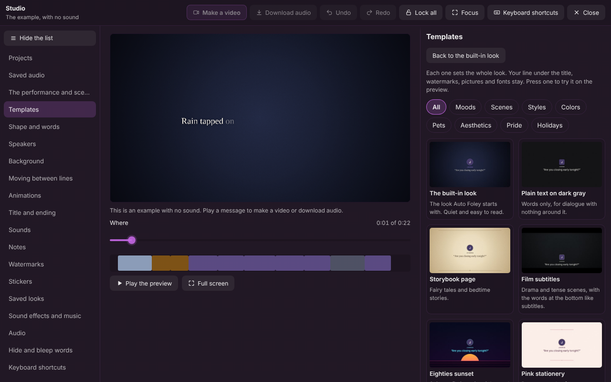
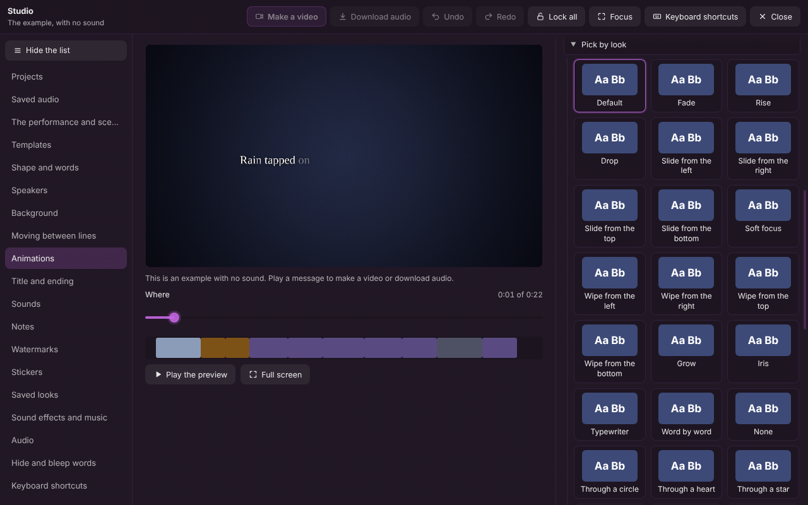
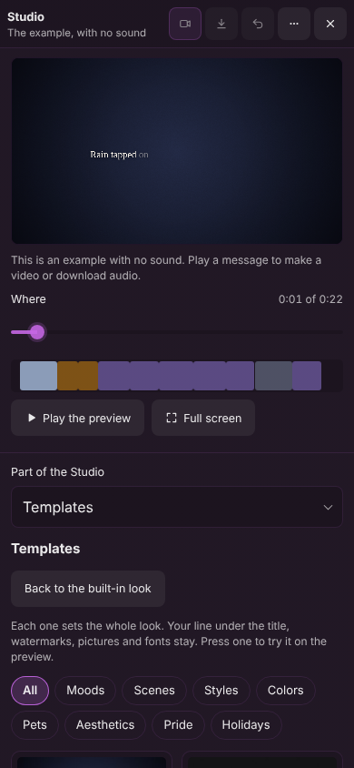
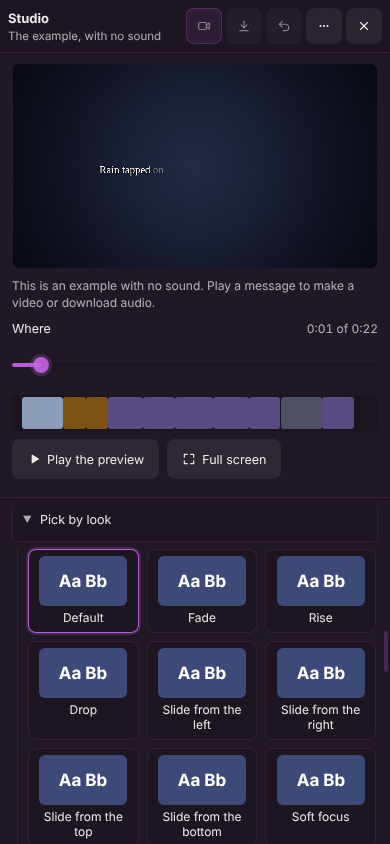

# A tour of the Studio

## In short

- The Studio turns a performance into a video, or saves it as audio.
- It opens over Lumiverse, with a large preview of the video.
- **Templates** gives the video a whole look with one press.
- **Background**, **Stickers**, **Animations** and the other parts change one thing at a time.
- **Make a video** saves the video the preview shows. **Download audio** saves the sound.
- Every change is saved as you make it.

## Steps

1. Play a message in a chat, so there is a performance to use. With none yet, the Studio shows an example with no sound.
2. Open the drawer's **Studio** tab and press **Open the Studio**.
3. Pick **Templates** in the list of parts. On a phone, the list is the **Part of the Studio** dropdown under the preview.
4. Press a template to try it on the preview. Press **Use this template** to keep it.
5. Press **Play the preview** to watch it.
6. Change anything you want, one part at a time. The preview changes at once.
7. Press **Make a video** at the top, or **Download audio**.
8. Press **Close**, or Escape on a keyboard.

## What it sends

Nothing. The video and the audio are made on your device. Your choices are kept on your account. See [Privacy](privacy.md).

## An example

Tamsin Reed has a performance of a quiet scene at a harbor, and wants a short video of it.

1. She opens the Studio. The preview shows her performance, with the built-in look.
2. Under **Templates**, she presses **Moods**, then **Pink stationery**. The preview tries it. She presses **Use this template**.
3. Under **Animations**, she opens **Pick by look** under **Lines**, and presses the card for **Rise**. Each line now rises in.
4. Under **Stickers**, she adds a small drawing of a lighthouse and drags it to the bottom right corner of the preview.
5. She presses **Play the preview** and watches it from the start.
6. She presses **Make a video**. The video is made as it plays, and saved when it ends.

## On a laptop

The parts of the Studio are listed on the left. The preview is in the middle. The settings of the part picked are on the right.

## On a phone

The preview is at the top. The settings are under it and scroll on their own. **Part of the Studio** picks which settings show. The buttons at the top show icons, and **More** holds **Redo**, **Lock all** and **Focus**.

## The parts

| Part | What it changes |
| --- | --- |
| Projects | Saves how a video is made, to open again later. See [Projects](studio.md#projects). |
| Saved audio | The performance the video uses. |
| The performance and scenes | Trims the start and end, and picks a background for each scene. |
| Templates | The whole look at once. See [Templates](studio.md#templates). |
| Shape and words | Wide or tall, and how the words look and show. |
| Speakers | Pictures and names. |
| Background | A color, a picture, or a design of shapes. |
| Moving between lines | The transition from one line to the next. |
| Animations | How each part comes in and goes out. See [Animations](studio.md#animations). |
| Title and ending | The title at the start, and the fade at the end. |
| Sounds | Sound captions, such as [thunder]. |
| Notes | Short lines of text over the video. |
| Watermarks | Your name or a logo on the video. |
| Stickers | Pictures of your own on the video. See [Stickers](studio.md#stickers). |
| Saved looks | Looks you saved, to use again. |
| Sound effects and music | How loud each is in the video. |
| Audio | The sound file Download audio saves. |
| Hide and bleep words | Words covered on screen and bleeped in the sound. |
| Keyboard shortcuts | Keys for the Studio, on a computer. |

For every setting, see [The Studio](studio.md).
